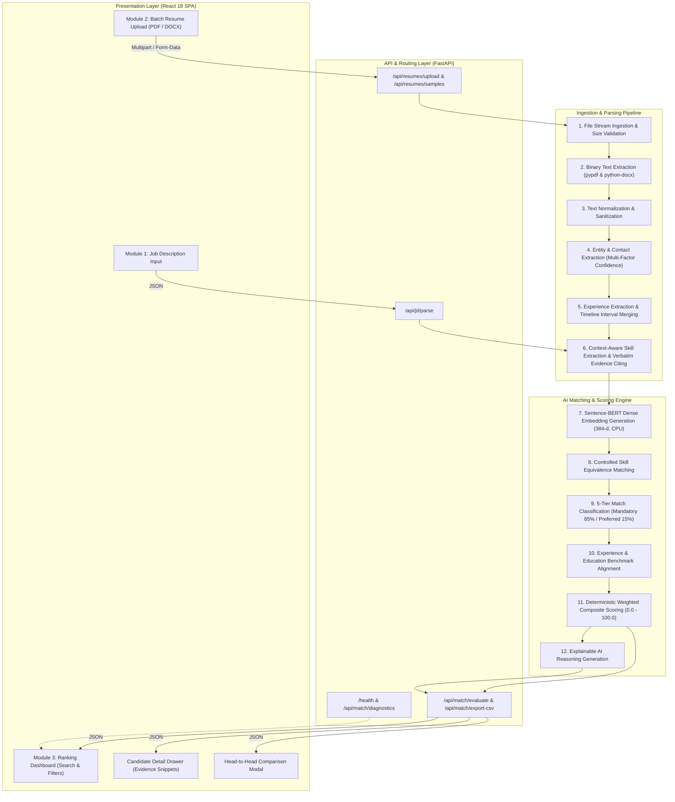

# MatchPro AI — Technical Architecture & Data Flow

This document details the end-to-end data processing pipeline, module responsibilities, error-handling mechanisms, and execution guarantees of the MatchPro AI Resume Matching and Candidate Ranking Engine.

---

## 1. End-to-End System Architecture

---

## 2. Detailed Data Flow Stages

### Stage 1: Document Upload & Stream Validation
- **Source File:** `backend/app/routes/resume_routes.py`
- **Input:** Multipart form upload stream (`UploadFile`).
- **Processing:** Validates file extension against `.pdf`, `.docx`, `.doc`, `.txt`. Rejects legacy binary `.doc` with explicit user conversion instructions. Validates file size ($\le 10$ MB per file) and batch size ($\le 30$ files per batch).
- **Output:** Validated raw file bytes in memory.
- **Error Handling:** Returns HTTP 400 for unsupported file extensions, oversized files, or empty file streams without crashing server worker.

### Stage 2: Binary Text Extraction
- **Source Files:** `backend/app/parsers/pdf_parser.py`, `backend/app/parsers/docx_parser.py`
- **Input:** Raw binary file bytes or in-memory file buffer (`io.BytesIO`).
- **Processing:**
  - For PDF: Reads page objects using `pypdf.PdfReader`, concatenates extracted page text streams.
  - For DOCX: Reads paragraphs and table cells using `docx.Document`, preserving table row associations.
- **Output:** Raw unformatted text string.
- **Error Handling:** Traps `pypdf.errors.PdfStreamError` and corrupt file exceptions gracefully, returning empty string and flagging `is_scanned_or_empty: True`.

### Stage 3: Text Normalization & Sanitization
- **Source File:** `backend/app/parsers/text_cleaner.py`
- **Input:** Raw extracted text string.
- **Processing:** Normalizes Unicode whitespace, converts smart quotes/dashes, eliminates null bytes, normalizes bullet points (`•`, `-`, `*`), and consolidates multi-line breaks.
- **Output:** Clean UTF-8 text string.
- **Error Handling:** Fallback returns original text if regex transformation encounters unexpected characters.

### Stage 4: Candidate Information & Confidence Extraction
- **Source File:** `backend/app/extractor/contact_extractor.py`
- **Input:** Clean candidate text.
- **Processing:**
  - Name: Scans header lines (excluding section title words). Fallback to cleaned filename.
  - Email: Regular expression validation (`EMAIL_REGEX`).
  - Phone: International phone pattern matching (`PHONE_REGEX`).
  - Education: Pattern matching for degree titles (`Ph.D.`, `Master's`, `Bachelor's`, `Associate`, `High School`) and graduation years. Absence defaults to `"Not Specified"`.
  - Confidence Rating: Calculates multi-factor rating (`ExtractionConfidence`) across Name, Contact, Experience, Education, and Skills.
- **Output:** `CandidateContact` and `CandidateEducation` Pydantic models.
- **Error Handling:** Absence of fields does not throw errors; explicitly marks `is_detected: False` and assigns confidence tier.

### Stage 5: Experience Extraction & Timeline Merging
- **Source File:** `backend/app/extractor/experience_extractor.py`
- **Input:** Clean candidate text.
- **Processing:**
  - Extracts explicit tenure mentions (e.g., `"5+ years of experience"`).
  - Extracts employment date spans (`MM/YYYY - MM/YYYY`, `YYYY - Present`).
  - Converts `"Present"` or `"Current"` dynamically using `datetime.now()` (no hardcoded current-year assumptions).
  - Executes `merge_intervals()` to merge overlapping concurrent positions chronologically along a unified timeline, eliminating double-counting.
- **Output:** `CandidateExperience` model with `total_years`, `calculated_years`, and `explicit_claimed_years`.
- **Error Handling:** If no dates or explicit claims are found, safely defaults to 0.0 years (or 0.5 yrs for intern keywords) with `Low` confidence.

### Stage 6: Context-Aware Skill Extraction & Evidence Citing
- **Source File:** `backend/app/extractor/skill_extractor.py`
- **Input:** Clean candidate text.
- **Processing:** Matches canonical terms against `ALIAS_MAP` (sorted by term length descending to avoid partial token collisions). Tracks occurrence frequencies and extracts 1–2 sentence verbatim evidence snippets (`find_evidence_snippet`).
- **Output:** List of canonical skill names and `evidence_map` containing frequencies and source snippets.
- **Error Handling:** Returns empty lists on empty input; skips malformed sentences.

### Stage 7: Dense Semantic Embeddings Generation
- **Source File:** `backend/app/matcher/embedding_engine.py`
- **Input:** Candidate section texts (Projects, Experience, Skills) and JD requirements.
- **Processing:** Singleton `SentenceTransformer("all-MiniLM-L6-v2")` encodes text strings into 384-dimensional unit-normalized dense vectors ($\|v\|_2 = 1.0$) on CPU.
- **Output:** NumPy array `(N, 384)` of dtype `float32`.
- **Error Handling:** If transformer library fails, initializes verified `TfidfVectorizer` fallback, pads vectors to 384 dimensions, and exposes `is_fallback: True` in `/health` diagnostics.

### Stage 8: Controlled Skill Equivalence & 5-Tier Classification
- **Source File:** `backend/app/matcher/skill_matcher.py`
- **Input:** Candidate skills, required skills, preferred skills, evidence map.
- **Processing:** Classifies each requirement into *Strong Match*, *Partial Match*, *Related Skill*, *Missing*, or *Insufficient Evidence*. Applies controlled equivalences (`Postgres` $\leftrightarrow$ `PostgreSQL`). Allocates 85% base score to mandatory requirements and 15% to preferred requirements. Versatility bonus (+0.5% per extra skill, max +5%) is strictly gated on mandatory score > 0.
- **Output:** `skill_score` (0.0 to 100.0), lists of matched/missing/additional skills, and `List[SkillMatchEvidence]`.
- **Error Handling:** Safe division handling if JD defines zero mandatory or preferred skills.

### Stage 9: Experience & Education Comparison
- **Source File:** `backend/app/matcher/experience_matcher.py`
- **Input:** Candidate experience/education vs JD minimum requirements.
- **Processing:**
  - Experience score: $\min(100.0, \frac{\text{Candidate Years}}{\text{Required Years}} \times 100.0)$. Excess tenure capped at 100.0%.
  - Education score: Full 100% if candidate matches or exceeds required qualification; 0.0% if missing/unspecified.
- **Output:** `experience_score` and `education_score` (0.0 to 100.0).

### Stage 10: Deterministic Weighted Composite Scoring
- **Source File:** `backend/app/matcher/scorer.py`
- **Input:** Component scores and `ScoringWeights` (Default: Skills 40%, Semantic 35%, Experience 20%, Education 5%).
- **Processing:** Normalizes weights ($\sum w_i = 1.0$). Rejects negative weights via Pydantic validators. Computes linear combination:
  $$S_{\text{overall}} = (w_s \cdot S_{\text{skills}}) + (w_e \cdot S_{\text{semantic}}) + (w_x \cdot S_{\text{exp}}) + (w_d \cdot S_{\text{edu}})$$
  Clamps final score strictly within $[0.0, 100.0]$.
- **Output:** `ScoreBreakdown` model.

### Stage 11: Explainable AI Reasoning Generation
- **Source File:** `backend/app/matcher/explainer.py`
- **Input:** Score breakdown, evidence map, tenure deltas, extraction confidence.
- **Processing:** Formulates human-readable verdict and lists concrete strengths and gaps citing verbatim sentence snippets from the candidate's resume.
- **Output:** `MatchExplanation` model.

### Stage 12: Candidate Ranking & Dashboard Presentation
- **Source Files:** `backend/app/routes/match_routes.py`, `frontend/src/components/CandidateRankingTable.jsx`
- **Input:** Ranked candidate results array.
- **Processing:** Ranks candidates descending by overall match score. React frontend renders interactive table, search filters, tenure filters, candidate detail drawer, head-to-head comparison modal, and CSV export.
- **Output:** Rendered UI and downloadable CSV file.
