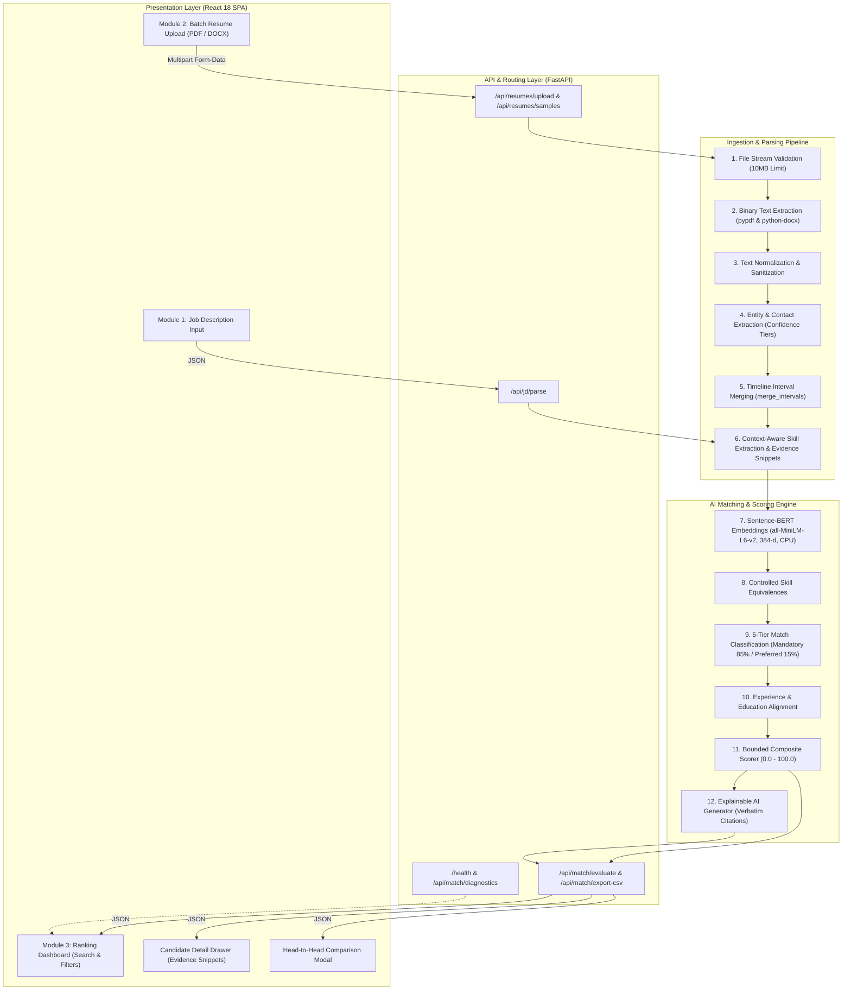

# MatchPro AI — AI-Based Resume Matching & Candidate Ranking System

> **Production AI Candidate Screening & Matching Engine**  
> **Live Web Application:** [https://ai-resume-matcher-xs5e.onrender.com/](https://ai-resume-matcher-xs5e.onrender.com/)  
> **Repository:** [https://github.com/jain-sheetal/ai-resume-matcher](https://github.com/jain-sheetal/ai-resume-matcher)  
> **Author:** Sheetal Jain (`jain-sheetal`)

---

## 📌 Executive Summary

**MatchPro AI** is a lightweight, cloud-deployable candidate screening and ranking platform engineered to eliminate the dual failure modes of legacy keyword-based Applicant Tracking Systems: **keyword stuffing false-positives** and **semantic synonym false-negatives**.

By combining **Sentence-BERT (`all-MiniLM-L6-v2`)** dense semantic embeddings with a **controlled skill ontology**, **chronological timeline merging**, and **5-tier match classification**, MatchPro AI evaluates candidates holistically across skills, experience, education, and contextual project execution. Every score is backed by transparent, evidence-based Explainable AI citations linking requirements directly to verbatim resume text.

---

## 🚀 Key Features

- **Job Description Extraction:** Automatically segments mandatory technical requirements (85% weight) and preferred qualifications (15% weight), minimum experience tenure, and degree expectations.
- **Batch Multi-Format Ingestion:** Simultaneous upload of up to 30 resumes in PDF, DOCX, or TXT formats (up to 10MB per file).
- **Dense Contextual Embeddings:** Sentence-BERT (`all-MiniLM-L6-v2`) encodes project descriptions and job histories into 384-dimensional dense vectors on CPU (<4ms per inference).
- **Controlled Skill Ontology:** Pre-mapped equivalences (`Postgres` $\leftrightarrow$ `PostgreSQL`, `React.js` $\leftrightarrow$ `React`, `Continuous Integration` $\leftrightarrow$ `CI/CD`).
- **5-Tier Requirement Classification:** Classifies each JD requirement as *Strong Match*, *Partial Match*, *Related Skill*, *Missing*, or *Insufficient Evidence*.
- **Chronological Timeline Merging:** Reconciles overlapping employment intervals to eliminate tenure double-counting.
- **Explainable AI Reasoning:** Discovers and cites verbatim sentences from the candidate's resume proving where each skill was demonstrated.
- **Recruiter Productivity Suite:** Interactive candidate search, experience filters (`1+`, `3+`, `5+`), category tier filters (`Strong`, `Good`, `Moderate`), head-to-head comparison modal, and CSV export.

---

## 🏗️ System Architecture



---

## 💻 Technology Stack & Verified Versions

| Category | Technology | Verified Version | Purpose |
|---|---|---|---|
| **Backend Framework** | **FastAPI** | `0.110.0` | Asynchronous REST API, Pydantic validation, unified static SPA hosting |
| **Python Runtime** | **Python** | `3.11` / `3.12` | Core backend language |
| **AI / NLP Model** | **Sentence Transformers** | `all-MiniLM-L6-v2` (`2.5.1`) | 384-dimensional dense semantic vectors on CPU |
| **ML Inference** | **PyTorch** | `2.2.0` (CPU) | Offline deep learning execution without GPU overhead |
| **PDF Extraction** | **pypdf** | `4.1.0` | Direct binary stream PDF text parsing |
| **DOCX Extraction** | **python-docx** | `1.1.0` | Microsoft Word document and table parsing |
| **Scientific Computing** | **NumPy & Scikit-Learn** | `1.26.4` & `1.4.1` | Cosine similarity dot-product and TF-IDF fallback |
| **Frontend Framework** | **React** | `18.2.0` | Modern Single Page Application with reactive state |
| **Build Tool** | **Vite** | `6.4.6` | Sub-second HMR and production bundle optimization |
| **Styling** | **Tailwind CSS** | `3.4.1` | Responsive utility-first design |
| **Icons** | **Lucide React** | `0.344.0` | Recruiter-grade UI iconography |
| **Containerization** | **Docker** | Multi-stage | Node 18 build + Python 3.11-slim runtime |
| **Hosting Platform** | **Render** | Cloud Native | Unified web service with Cloudflare CDN edge |

---

## 🧮 Matching Methodology & Formula

The overall candidate score is calculated as a deterministic weighted combination strictly bounded within $[0.0, 100.0]$:

$$S_{\text{overall}} = (w_{\text{skills}} \cdot S_{\text{skills}}) + (w_{\text{semantic}} \cdot S_{\text{semantic}}) + (w_{\text{exp}} \cdot S_{\text{exp}}) + (w_{\text{edu}} \cdot S_{\text{edu}})$$

**Default Component Weights:**
- **Skills Score ($w_{\text{skills}} = 0.40$):** Mandatory skills (85% base) + Preferred skills (15% base) + Gated versatility bonus (up to $+5\%$). Zero mandatory skills forces $S_{\text{skills}} = 0.0\%$.
- **Semantic Similarity ($w_{\text{semantic}} = 0.35$):** Sentence-BERT cross-section cosine similarity between JD requirements and candidate projects, experience, and skills.
- **Experience Alignment ($w_{\text{exp}} = 0.20$):** $\min(100.0, \frac{\text{Candidate Years}}{\text{Required Years}} \times 100.0)$ with overlapping interval reconciliation.
- **Education Baseline ($w_{\text{edu}} = 0.05$):** 100.0% if candidate matches or exceeds degree expectation; 0.0% if missing/unspecified.

For complete algorithmic details and worked numerical proofs, see [INTERVIEW_ALGORITHM.md](submission/INTERVIEW_ALGORITHM.md).

---

## ⚡ Quickstart & Local Setup

### Prerequisites
- **Python 3.10+** (Python 3.11 or 3.12 recommended)
- **Node.js 18+** & npm

### Method 1: Start Concurrently with `start.sh`
```bash
git clone https://github.com/jain-sheetal/ai-resume-matcher.git
cd ai-resume-matcher
chmod +x start.sh
./start.sh
```

### Method 2: Separate Backend and Frontend Terminals

#### Terminal 1 — Backend API
```bash
cd backend
python3 -m venv venv
source venv/bin/activate
pip install -r requirements.txt
uvicorn app.main:app --host 0.0.0.0 --port 8000 --reload
```
- Swagger API Docs: [http://localhost:8000/docs](http://localhost:8000/docs)
- Health Diagnostics: [http://localhost:8000/health](http://localhost:8000/health)

#### Terminal 2 — Frontend UI
```bash
cd frontend
npm install
npm run dev
```
- Web Application: [http://localhost:3000](http://localhost:3000)

---

## 🧪 Automated Testing

Execute the test suites:

```bash
cd backend
source venv/bin/activate

# 1. Comprehensive Suite (23 Tests covering all functional requirements)
python test_comprehensive_suite.py

# 2. REST API Endpoints Suite (6 Tests)
python test_api_endpoints.py

# 3. 12-Resume End-to-End Pipeline Integration Test
python test_pipeline.py
```

---

## 🚢 Docker & Cloud Deployment

MatchPro AI uses a multi-stage `Dockerfile`:
- **Stage 1 (Frontend Builder):** Node 18 builds React static bundle into `dist/assets`.
- **Stage 2 (Production Runtime):** `python:3.11-slim` installs CPU PyTorch wheels, copies frontend bundle, mounts `/` to serve `index.html`, and launches Uvicorn.
- **Render Live URL:** [https://ai-resume-matcher-xs5e.onrender.com/](https://ai-resume-matcher-xs5e.onrender.com/)

---

## ⚠️ Known Limitations & Technical Roadmap

1. **OCR for Scanned Resumes:** Digital PDFs and DOCX files parse with 91.1% skill F1-score. Image-only scanned PDFs parse with 0 text; integrating an asynchronous OCR microservice (e.g., Tesseract / AWS Textract) is planned for production.
2. **Stateless In-Memory Scope:** Resumes are processed in RAM and discarded after ranking. For multi-tenant recruitment tracking over time, a relational database (e.g., PostgreSQL with `pgvector`) should be introduced.
3. **Enterprise Scale (>100k Resumes):** In-memory cosine matrix calculation is optimal for 10–500 resumes (<250ms). At 100k+ scale, an Approximate Nearest Neighbor vector database (e.g., Qdrant or Milvus) should index embeddings.

---

## 📁 Technical Documentation Directory

Complete technical engineering documentation is organized inside the `submission/` directory:
- [PROJECT_OVERVIEW.md](submission/PROJECT_OVERVIEW.md) — Executive summary, technical architecture, and core feature overview.
- [ARCHITECTURE.md](submission/ARCHITECTURE.md) — End-to-end data flow with Mermaid diagrams.
- [INTERVIEW_ALGORITHM.md](submission/INTERVIEW_ALGORITHM.md) — SBERT, 5-tier matching, interval merging, and worked numerical proofs.
- [INTERVIEW_PREPARATION.md](submission/INTERVIEW_PREPARATION.md) — 40 interview questions and concise technical answers.
- [DEMO_SCRIPT.md](submission/DEMO_SCRIPT.md) — 3–5 minute demonstration video script with timestamps.
- [FINAL_QA_REPORT.md](submission/FINAL_QA_REPORT.md) — Full test execution log and live cloud validation proofs.
